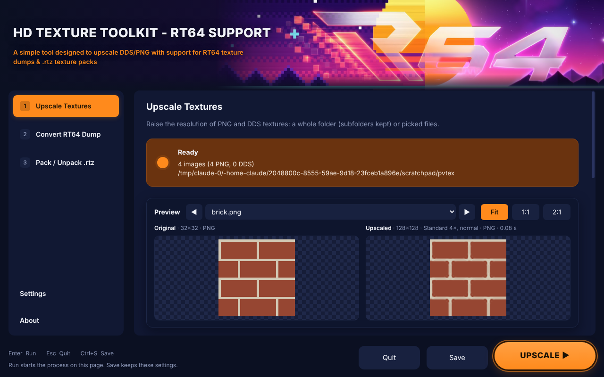
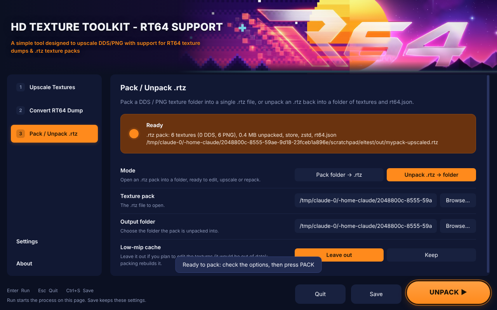

# R64texHD: HD Texture Toolkit - RT64 Support

A simple, portable Windows tool to upscale DDS / PNG textures, with support for
RT64 texture dumps and `.rtz` texture packs.



## Features

**1 · Upscale Textures**
- Upscale a whole folder of PNG / DDS textures (subfolders kept) or picked files.
- Methods: **Standard** (enlarges 2× at a time and re-sharpens after every step),
  **Smooth**, **Pixel art**, and **AI** (Real-ESRGAN, optional download).
- Size 2× / 3× / 4× / 6× / 8×, or fit the longest side to 512–4096 px.
- Sharpness, tiling edges (normal / tile / mirror), hard or smooth cut-out alpha.
- Output as the same format, PNG, or DDS (BC1, BC3, BC7 via texconv, uncompressed), with full mip chains.
- **Live side-by-side preview** that re-renders whenever a setting changes
  (DDS output previews its compression too), with Fit / 1:1 / 2:1 zoom.
- When it finishes, it offers to pack the result into an `.rtz`.

**2 · Convert RT64 Dump**
- Turns RT64 texture dumps (`<hash>.v<N>.tmem` + `.tile.json`, from RT64's debugger:
  F1 › Textures › Start dumping textures) into PNG or DDS plus a ready-made `rt64.json`.
- Decoded with a port of RT64's own texture decoder, so images match what RT64 hashes.
- When it finishes, it asks whether to pack the result into an `.rtz`.

**3 · Pack / Unpack .rtz**
- Pack a DDS / PNG texture folder into an `.rtz` in the same layout as RT64's
  `texture_packer` (Zstandard, Deflate or Store; low-mip cache for DDS streaming).
- Unpack any `.rtz` back into a folder of textures and `rt64.json`.



**Portable:** nothing is installed. Settings, downloaded tools and temporary files
stay in a `data` folder next to `R64texHD.exe`, never in AppData.

## Download and run

1. Download `R64texHD-Windows.zip` from [Releases](../../releases).
2. Unzip it anywhere you can write to (for example `C:\Tools\R64texHD`).
3. Run **R64texHD.exe**. The first launch asks for your RT64 dump folder (optional)
   and an output folder.

The release is not code-signed, so Windows SmartScreen may warn the first time:
choose **More info › Run anyway**.

## Building from source

The app is plain JavaScript on [Electron](https://www.electronjs.org/) with no npm
dependencies: everything (PNG and DDS codecs, BC1/BC3 encoder, BC1–BC7 decoders,
upscaler, `.rtz` zip writer) is in `app/core`.

Run it during development (Electron 38 installed or downloaded from its releases):

```
electron app
```

Build the portable Windows release (Linux, macOS, or Windows with Git Bash / WSL;
needs `curl`, `unzip`, Python 3 with Pillow):

```
build/package.sh
```

This downloads Electron 38.4.0 for win32-x64, writes the app icon and the
`R64texHD` version info into the exe (`build/set_icon.py`, `build/set_version.py`),
and produces `dist/R64texHD-Windows.zip`.

## Project layout

```
app/
  main.js          window, settings (portable data folder), dialogs, tasks, tool downloads
  preload.js       the bridge between the page and the app
  ui/index.html    the launcher
  core/            png, dds, bc (block codecs), upscale, tmem (RT64 dumps),
                   rt64db (rt64.json), rtz (packs), tasks + worker (parallel jobs)
build/             packaging scripts
docs/              README.txt shipped in the release, screenshots
```

## Licence

MIT, see [LICENSE](LICENSE). Parts are ported from RT64 and bcdec (both MIT);
see [THIRD_PARTY_NOTICES.md](THIRD_PARTY_NOTICES.md). The RT logo belongs to the
RT64 project and is not covered by this repository's licence.
