# R64texHD - Reimagine Every Pixel

**HD textures for N64 games** · current version **v0.7.1.1** · Windows x64

R64texHD is an all-in-one tool for N64 HD texture packs. It gets textures out of
RT64 dumps and Ship port archives, upscales them, and packs them back up for
RT64 emulators, recomps and Ship ports. It also brings classic Rice / GLideN64
packs along, and has a quick ROM explorer for looking inside your N64 ROMs.

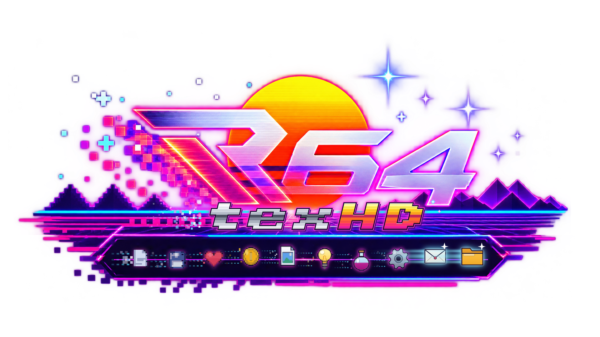

## Features

**1 · Upscale Textures**
- Upscale a whole folder of PNG / DDS textures (subfolders kept) or picked files.
- Methods: **Standard** (grows 2× at a time and re-sharpens after every step),
  **Smooth**, **Pixel art**, and **AI** (Real-ESRGAN, optional download).
- Size 2× / 3× / 4× / 6× / 8×, or fit the longest side to 512–4096 px.
- **Edges: Auto** (new): every texture uses its own tiling from the RT64 dump,
  so repeating floors and walls stay seamless without sorting them by hand.
  Or pick Normal / Tile / Mirror for everything.
- **Fences far away** (new): DDS mipmaps keep cut-out textures (fences, grass,
  leaves) as solid in the distance as up close, instead of fading away.
- Output as the same format, PNG, or DDS (BC1, BC3, BC7 via texconv, uncompressed),
  with full mip chains (odd sizes included).
- **Live side-by-side preview** that re-renders whenever a setting changes.

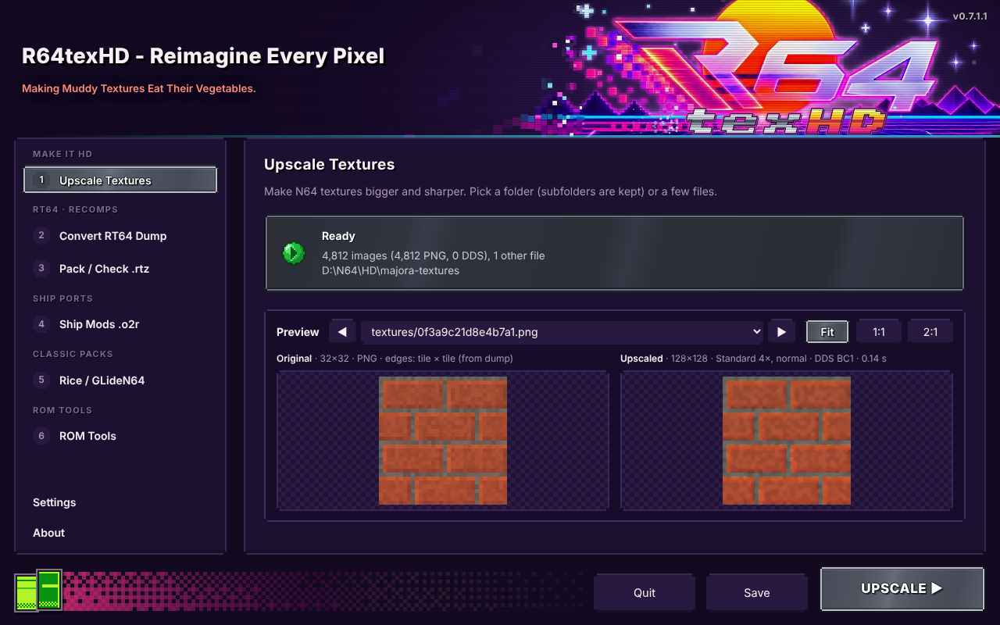

**2 · Convert RT64 Dump**
- Turns RT64 texture dumps (`<hash>.v<N>.tmem` + `.tile.json`, from RT64's debugger:
  F1 › Textures › Start dumping textures) into PNG or DDS plus a ready-made `rt64.json`.
- Decoded with a port of RT64's own texture decoder, so images match what RT64 hashes.
- **Remember tiling** (new): saves how each texture repeats for Edges: Auto.
- **Only new textures** (new): play further, dump more, and convert just the new ones;
  `rt64.json` is updated, not replaced.

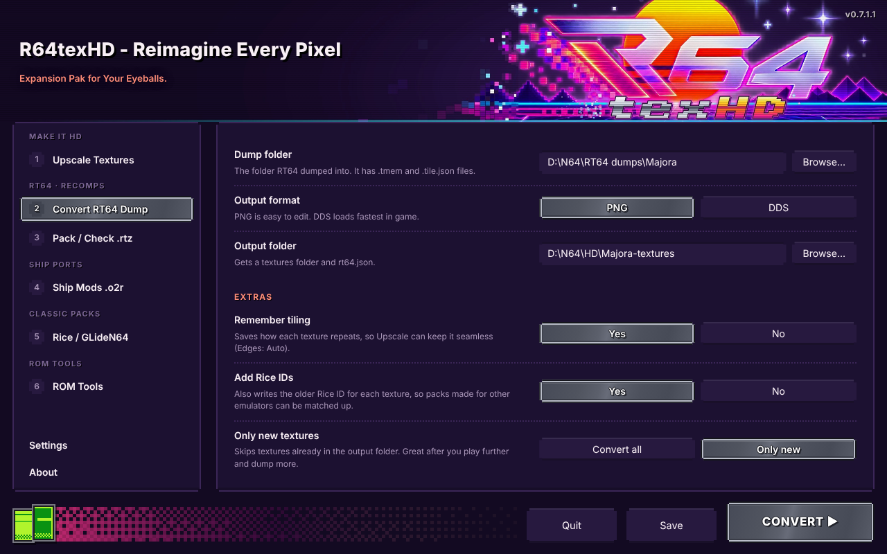

**3 · Pack / Check .rtz**
- Pack a DDS / PNG texture folder into an `.rtz` in the same layout as RT64's
  `texture_packer` (Zstandard, Deflate or Store; low-mip cache for DDS streaming).
- **Recomp mod info** (new): give the pack a name, author, version, description and
  picture for the mod menu in Zelda 64: Recompiled and other recomps, plus an on / off
  switch players can flip in game. Written as `mod.json` + `thumb.png` inside the `.rtz`,
  following Recomp's own rules.
- **Check a pack** (new): looks over an `.rtz` or a pack folder before you share it,
  following RT64's texture pack advice: PNG textures left in, missing files, DDS without
  mipmaps, the low-mip cache size, very large textures, preloads, unused images and the
  Recomp mod info. Nothing is changed.
- **Make them DDS** (new): one click turns the PNG textures into DDS (BC7 with texconv)
  in a fixed copy of the pack, `<name>-fixed.rtz`, then checks it again. The original stays as it was.
- Unpack any `.rtz` back into a folder of textures and `rt64.json` (Recomp info included).

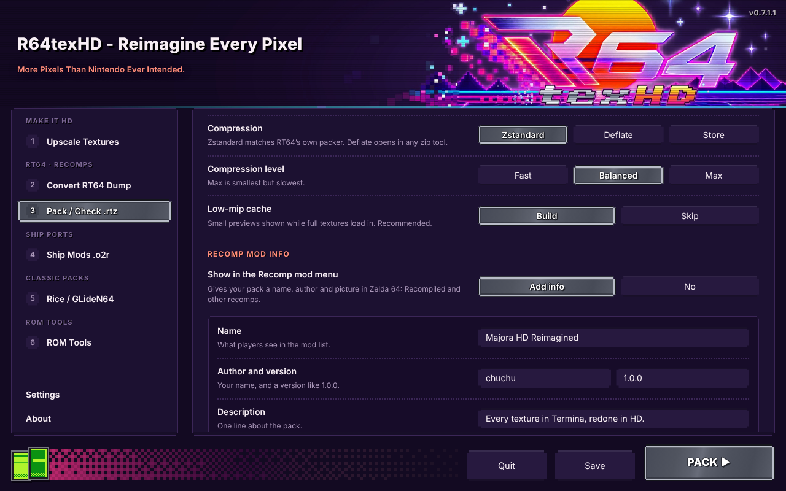

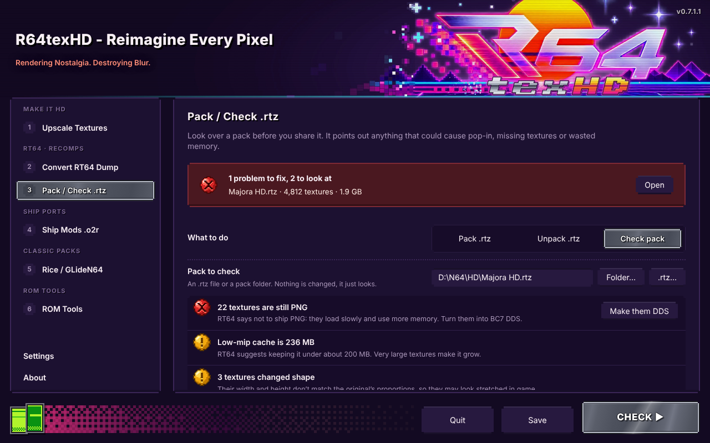

**4 · Ship Mods .o2r**
- For the PC ports built on libultraship: 2 Ship 2 Harkinian, Ship of Harkinian,
  Starship and other `.o2r` ports.
- **Get textures**: every texture in the game's `.o2r` (made by the port from your ROM)
  as a PNG, in the same folders as inside the archive. Palette textures come out grey,
  because their colours live in a separate palette: paint them in colour for HD.
- Then **1 · Upscale** the folder (as PNG; "Upscale these" sets that for you).
- **Build HD mod**: each PNG replaces the texture at the same path. HD textures are
  stored the way HarbourMasters' Retro tool stores them (RGBA32 at a whole multiple of
  the original size, with the scale the renderer needs); textures that aren't a whole
  multiple are fitted. With **In-game switch** the textures sit under `alt/`, so players
  flip them with "Use Alternate Assets" (Tab). Put the `.o2r` in the port's `mods` folder.
- Older MPQ `.otr` archives aren't supported; ports make `.o2r` now.

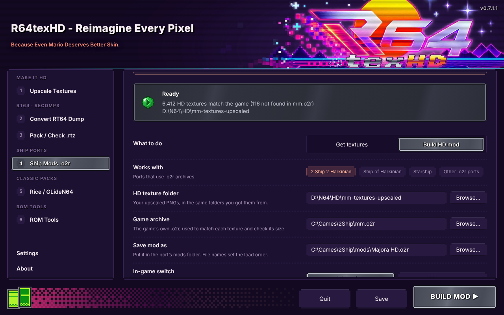

**5 · Rice / GLideN64**
- **Rice IDs**: Convert RT64 Dump can add each texture's Rice ID to `rt64.json`
  ("Add Rice IDs"), worked out from the `.rice` files RT64 dumps, the same way RT64's
  own `texture_hasher --rice` does. That is what links RT64 to classic packs.
- **Use in RT64**: brings a classic pack (a Rice PNG folder, or a GLideN64 `.hts` /
  `.htc`) into RT64 and recomps, matched through your converted dump. The result is a
  normal pack folder (`textures/<hash>.png` + `rt64.json`) to upscale, pack and check.
- **Make GLideN64**: turns a folder with Rice IDs (in `rt64.json`, or Rice-named PNGs)
  into a GLideN64 `.hts` pack for Project64, RetroArch, RMG and BizHawk ("Texture Hires
  File Storage").
- **Use in a Ship port**: matches a classic pack to the textures in a Ship port's `.o2r`
  by Rice ID and builds an HD mod (with the in-game switch).
- Classic pack files can be several GB: `.hts` packs are read a texture at a time.

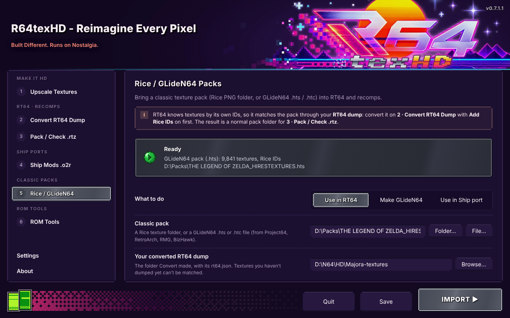

**6 · ROM Tools**

A quick explorer for your N64 ROM collection. It only reads ROMs, never changes them.

- **Opening ROM Tools asks where your ROMs are** (when no folder is set yet).
- **Pick your ROM folder** and it is searched straight away, subfolders included.
  Found: `.z64` (big-endian), `.v64` (byte-swapped), `.n64` (little-endian), `.rom`,
  `.bin`, `.u64`, and `.zip` files with a ROM inside. Files with a ROM-like name that
  aren't N64 ROMs are skipped. The folder is scanned again whenever you pick it, or
  press **SCAN**.
- **The list** is grouped by folder, so you see how the collection is laid out, and
  shows each ROM's title, game code, region and format. **Search** filters by title,
  file name, game code or folder. A small **?** marks ROMs that aren't in the N64 library.
- **The counter** under the folder shows how much of the North American N64 library you
  have: "ROM: 37 out of 303 (NTSC) titles found". Each game counts once, however many
  copies or regions of it you have.
- **Box art and description**: clicking a ROM shows its 3D box at the top right and a
  short description of the game beside it (long ones scroll by themselves; hover to
  pause). A faded copy of the box sits behind the details. Games are matched by the game
  ID in the ROM header (`NMQE` = Paper Mario), so a Japanese or European copy shows the
  same box. A ROM that isn't in the library says *"No ROM match found, what is this game?"*
- **Click a ROM** to see:
  - **Game**: title, game code, type (cartridge, 64DD…), game ID, region with NTSC /
    PAL, and version.
  - **File**: name, folder, byte order, size in MB and Mbit, the ROM inside a `.zip`,
    and padding at the end.
  - **Boot and checksum**: the CIC lockout chip (found from the boot code), and whether
    the header checksum (CRC1 / CRC2) matches the one the boot code calculates. A
    mismatch usually means a hack or a bad dump. Also the entry point, clock rate and
    libultra version.
  - **Hashes**: CRC32, MD5 and SHA-1 of the whole ROM in `.z64` order, the same as No-Intro
    and most ROM databases, so `.v64` / `.n64` copies match too. They can be selected
    and copied.
  - **Inside the ROM**: a map of the header, boot code and game data. For Zelda 64
    engine games (Ocarina of Time, Majora's Mask and their hacks) it also finds the
    file table: how many files, how many are compressed, and the build name and date.
- **Show in folder** opens the ROM's folder with the file selected.

The library (`app/assets/n64/games.json`, 303 games) is made by
`build/n64-library/make-games.py` from the box art and a description list, with each
title's game code looked up in the [libretro N64 databases](https://github.com/libretro/libretro-database)
(No-Intro first, as its codes are read from the ROM headers).

The checksum follows `n64crc.c` for CIC-6101/6102 (7101), 6103 (7103), 6105 (7105) and
6106 (7106). CIC-7102 and the 64DD's 8303 are named but not checked.

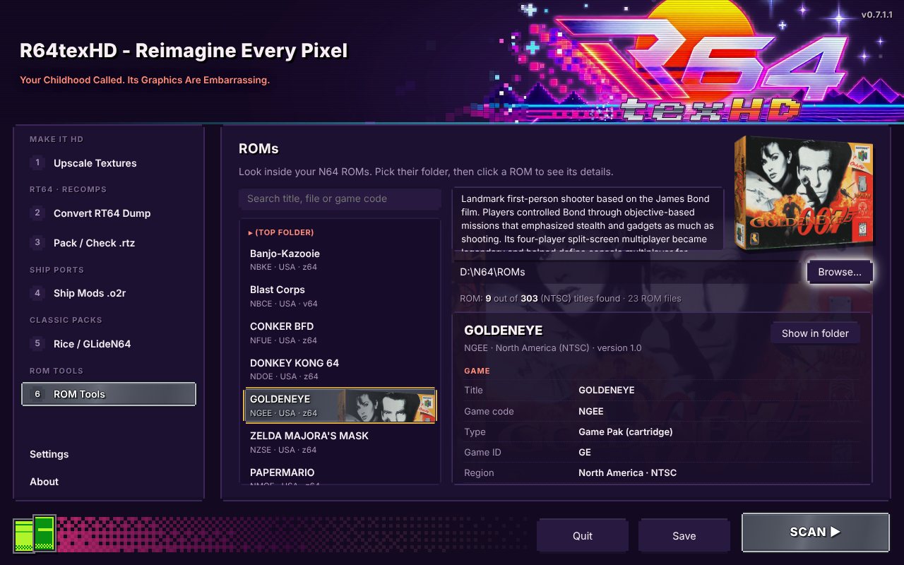

**Settings**
- **Folders**: the default output folder for everything R64texHD makes. (The RT64
  dump folder is set on 2 · Convert RT64 Dump.)
- **Helper tools**: texconv (sharp BC7 DDS textures, and keeps far-away fences visible)
  and Real-ESRGAN (AI upscaling, needs a Vulkan graphics card). Each shows
  **Downloaded** or **Not downloaded**, downloads with one click to the portable
  `data` folder, and is checked against a fixed checksum. **Locate…** points to a copy
  you already have.
- **Check tools at startup**: if a tool is missing, a small window asks *"New install,
  who dis? Download Helper Tools?"*, listing the tools and their sizes. **Yes** downloads
  them, **No** carries on. Can be turned off.
- **AI upscaling**: the model (General, Art, Fast art), which graphics card to use, and
  GPU memory use (pick Low if AI upscaling crashes or the card has little memory).
- **Performance**: worker threads (Auto, Half, One) and the largest texture size
  upscaling may reach (2048 / 4096 / 8192 px).
- **Look and feel**:
  - **Splash screen**: On or Off. When on, R64texHD opens with a 3.5 s intro showing
    the logo and a random catchphrase; a click or any key skips it. When off, the app
    opens straight away.
  - **Catchphrases**: **Full send** uses the whole list; **Keep it clean** leaves out
    every catchphrase with swearing, both on the splash screen and in the header
    subtitle, which shows a new catchphrase each time you switch page.
- **Desktop shortcut** to this portable copy, and the **Portable data** folder
  (settings, tools and temporary files; nothing goes in AppData).

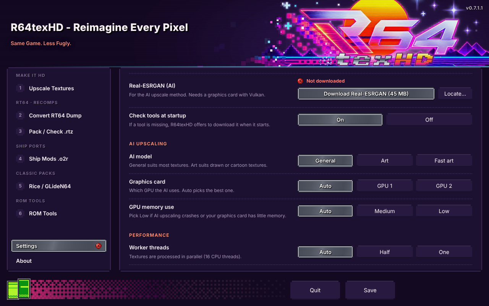

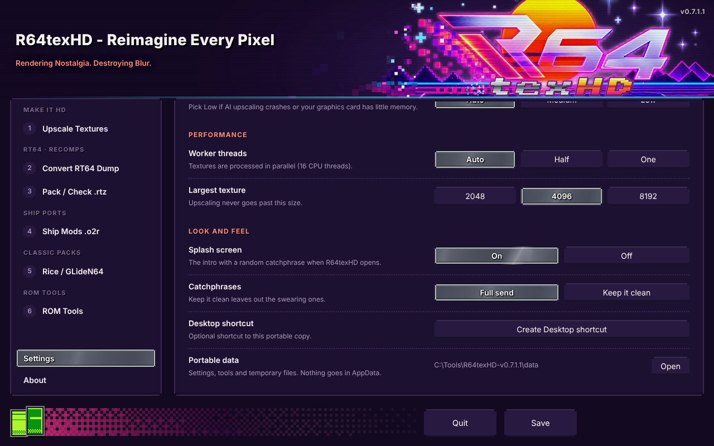

**Welcome**
- R64texHD opens straight away, with nothing to set up first (the output folder lives in
  Settings). The first launch opens on the Welcome page, and the green pixel button at
  the bottom left brings you back to it any time. It also has the Desktop shortcut and
  shows where settings are kept.

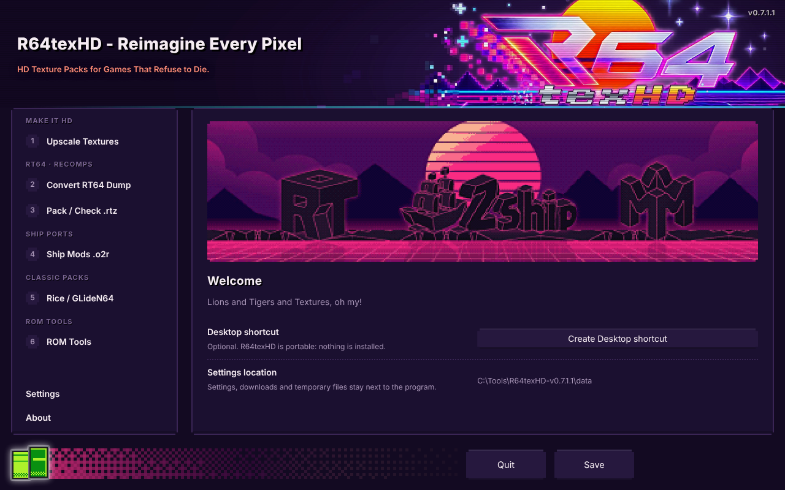

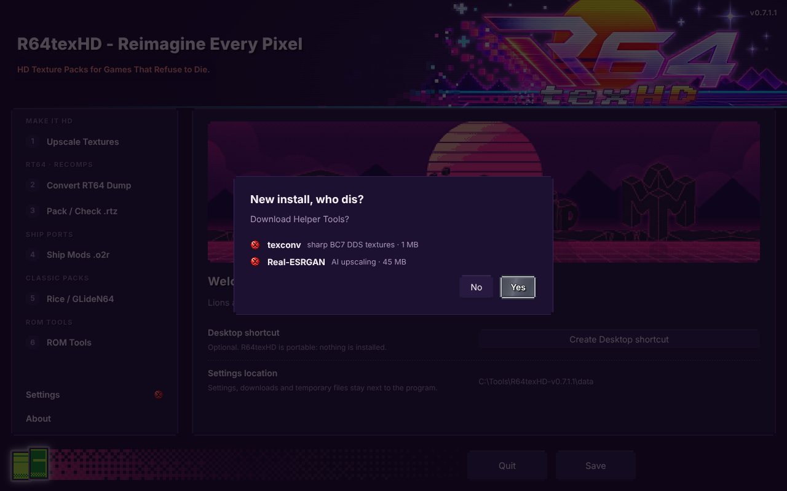

**Portable:** nothing is installed. Settings, downloaded tools and temporary files
stay in a `data` folder next to `R64texHD.exe`, never in AppData.

## Download and run

1. Download `R64texHD-v0.7.1.1-Windows.zip` from [Releases](../../releases).
2. Unzip it anywhere you can write to. It unzips to a `R64texHD-v0.7.1.1` folder
   (for example `C:\Tools\R64texHD-v0.7.1.1`).
3. Run **R64texHD.exe**. The first launch asks for an output folder (the RT64 dump
   folder is chosen on 2 · Convert RT64 Dump).
4. If the optional tools (texconv for BC7, Real-ESRGAN for AI upscaling) aren't
   downloaded yet, R64texHD opens on **Settings** so you can fetch them with one
   click, or choose **Not now**. The check can be turned off in Settings.

Updating: unzip the new version next to the old one and copy the old `data` folder
into it to keep your settings and downloaded tools.

The release is not code-signed, so Windows SmartScreen may warn the first time:
choose **More info › Run anyway**.

## Building from source

The app is plain JavaScript on [Electron](https://www.electronjs.org/) with no npm
dependencies: everything (PNG and DDS codecs, BC1/BC3 encoder, BC1–BC7 decoders,
upscaler, `.rtz` zip writer) is in `app/core`.

Run it during development (Electron 38 installed or downloaded from its releases):

```
electron app
```

Build the portable Windows release (Linux, macOS, or Windows with Git Bash / WSL;
needs `curl`, `unzip`, Python 3 with Pillow):

```
build/package.sh
```

This downloads Electron 38.4.0 for win32-x64, writes the app icon and the
`R64texHD` version info into the exe (`build/set_icon.py`, `build/set_version.py`),
and produces `dist/R64texHD-v<version>-Windows.zip` (the version comes from
`app/package.json`, the one place it is set). The exe icon is `app/assets/icon.ico`
(the same file the app window uses), all seven sizes from 16 to 256 px:
`set_icon.py` rebuilds the exe's resource section around it, the way a resource
editor would.

## Project layout

```
app/
  main.js          window, settings (portable data folder), dialogs, tasks, tool downloads
  preload.js       the bridge between the page and the app
  ui/index.html    the launcher (pages, splash screen, live preview)
  ui/pixel-icons.js  the pixel-art status buttons
  core/            png, dds, bc (block codecs), upscale, tmem (RT64 dumps), tiling (Edges: Auto),
                   rt64db (rt64.json), rtz (packs), recomp (mod.json), check (Check a pack), o2r (Ship ports),
                   rice + legacy (Rice IDs, GLideN64 packs, classic packs; GPL), rom (ROM Tools),
                   tasks + worker (parallel jobs)
build/             packaging scripts; ui-preview/ makes UI screenshots (docs-shots.py for the README)
                   and runs the app self-test
tests/             automated tests: node --test tests/*.test.js
docs/              README.txt shipped in the release, screenshots
```

## Testing

```
node --test tests/core.test.js tests/check.test.js tests/o2r.test.js tests/rice.test.js tests/rom.test.js
```

Needs Node 22.15 or newer (the same Node that Electron 38 uses). The tests cover
the image formats, mipmaps (fences far away, odd sizes), RT64 dump tiling and
Edges: Auto, Convert's "Only new", `.rtz` pack / unpack, Recomp mod info,
Check a pack and the Make them DDS fix, Ship `.o2r` textures and mods, Rice IDs (checked
against RT64 `texture_hasher`'s own C++, see `build/rice-check`), GLideN64 `.hts` / `.htc`,
the three classic pack modes, the AI options, and ROM Tools (all three byte orders, `.zip`,
the checksum for every CIC compared with a separate port of `n64crc.c`, and the Zelda 64
file table).

## Why was this made?

R64texHD was created to simplify the entire RT64 texture upscaling workflow — from
extracting textures and converting them to PNG/DDS, to upscaling them and repacking
them into `.rtz` texture packs for compatible N64 emulators, renderers, and ports —
all in one tool.

## How this was made

R64texHD was vibe coded with **Claude Opus 5.5**. The author has **zero**
understanding of code: every line here came from describing what the tool should
do, testing it, and asking for changes until it worked. What the author did bring
was the drive to make something and to give the community a free tool for
building HD texture packs.

If you know your way around code, issues and pull requests are welcome. If you
don't, that's fine too: this project shows that you can still build something
useful.

## Licence

GPL-2.0-or-later, see [LICENSE](LICENSE). From v0.7.1.1 R64texHD is GPL because the Rice /
GLideN64 support (page 5) uses the Rice texture ID formula from GLideN64 and Rice Video
(GPL), as RT64's own `texture_hasher` does. Earlier versions were MIT. Parts are ported
from RT64 and bcdec (both MIT, which can be used in GPL software); see
[THIRD_PARTY_NOTICES.md](THIRD_PARTY_NOTICES.md). The R64 icon, splash and header artwork
were supplied by the project author.

### Credits

- **N64 box art scans** (ROM Tools): **Kondorito**, from the
  [Nintendo 64 3D Boxes Pack (Real Version)](https://emumovies.com/files/file/3117-nintendo-64-3d-boxes-pack-real-version)
  on EmuMovies.
- **Game codes** for the box art: the [libretro-database](https://github.com/libretro/libretro-database)
  N64 lists (No-Intro and serial).
