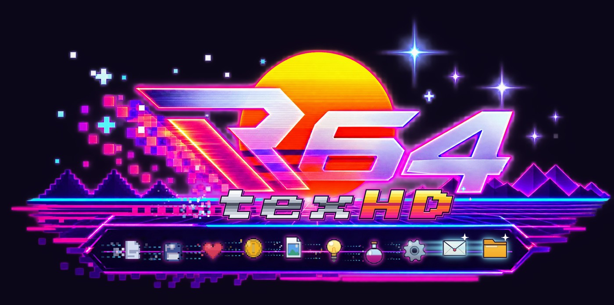
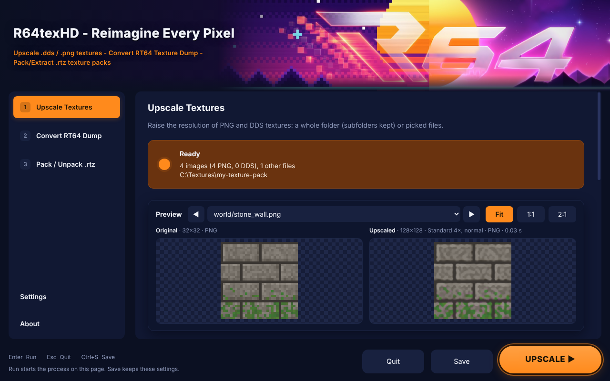

# R64texHD - Reimagine Every Pixel

**HD textures for N64 games** · current version **v0.7.1.1** · Windows x64

R64texHD is an all-in-one tool for N64 HD texture packs. It gets textures out of
RT64 dumps and Ship port archives, upscales them, and packs them back up for
RT64 emulators, recomps and Ship ports. It also brings classic Rice / GLideN64
packs along.



## Features

**1 · Upscale Textures**
- Upscale a whole folder of PNG / DDS textures (subfolders kept) or picked files.
- Methods: **Standard** (grows 2× at a time and re-sharpens after every step),
  **Smooth**, **Pixel art**, and **AI** (Real-ESRGAN, optional download).
- Size 2× / 3× / 4× / 6× / 8×, or fit the longest side to 512–4096 px.
- **Edges: Auto** (new): every texture uses its own tiling from the RT64 dump,
  so repeating floors and walls stay seamless without sorting them by hand.
  Or pick Normal / Tile / Mirror for everything.
- **Fences far away** (new): DDS mipmaps keep cut-out textures (fences, grass,
  leaves) as solid in the distance as up close, instead of fading away.
- Output as the same format, PNG, or DDS (BC1, BC3, BC7 via texconv, uncompressed),
  with full mip chains (odd sizes included).
- **Live side-by-side preview** that re-renders whenever a setting changes.

**2 · Convert RT64 Dump**
- Turns RT64 texture dumps (`<hash>.v<N>.tmem` + `.tile.json`, from RT64's debugger:
  F1 › Textures › Start dumping textures) into PNG or DDS plus a ready-made `rt64.json`.
- Decoded with a port of RT64's own texture decoder, so images match what RT64 hashes.
- **Remember tiling** (new): saves how each texture repeats for Edges: Auto.
- **Only new textures** (new): play further, dump more, and convert just the new ones;
  `rt64.json` is updated, not replaced.

**3 · Pack / Check .rtz**
- Pack a DDS / PNG texture folder into an `.rtz` in the same layout as RT64's
  `texture_packer` (Zstandard, Deflate or Store; low-mip cache for DDS streaming).
- **Recomp mod info** (new): give the pack a name, author, version, description and
  picture for the mod menu in Zelda 64: Recompiled and other recomps, plus an on / off
  switch players can flip in game. Written as `mod.json` + `thumb.png` inside the `.rtz`,
  following Recomp's own rules.
- **Check a pack** (new): looks over an `.rtz` or a pack folder before you share it,
  following RT64's texture pack advice: PNG textures left in, missing files, DDS without
  mipmaps, the low-mip cache size, very large textures, preloads, unused images and the
  Recomp mod info. Nothing is changed.
- **Make them DDS** (new): one click turns the PNG textures into DDS (BC7 with texconv)
  in a fixed copy of the pack, `<name>-fixed.rtz`, then checks it again. The original stays as it was.
- Unpack any `.rtz` back into a folder of textures and `rt64.json` (Recomp info included).

**4 · Ship Mods .o2r** *(coming in the next builds)*
- Get the textures out of a Ship port's `.o2r` / `.otr` (2 Ship 2 Harkinian,
  Ship of Harkinian, Starship and other libultraship ports), upscale them, and
  build an HD mod for the port's `mods` folder, with the in-game "Use Alternate
  Assets" switch.

**5 · Rice / GLideN64** *(coming in the next builds)*
- Bring classic Rice PNG folders and GLideN64 `.hts` / `.htc` packs into RT64,
  make GLideN64 packs for Project64, RetroArch, RMG and BizHawk, and turn Rice
  packs into Ship port mods.

**Settings**
- Helper tools (texconv for BC7, Real-ESRGAN for AI) download with one click and
  are checked against a fixed checksum. R64texHD checks for them at startup.
- AI options: model, graphics card and GPU memory use.
- Splash screen and catchphrases on or off, or "Keep it clean".

**Portable:** nothing is installed. Settings, downloaded tools and temporary files
stay in a `data` folder next to `R64texHD.exe`, never in AppData.

## Download and run

1. Download `R64texHD-v0.7.1.1-Windows.zip` from [Releases](../../releases).
2. Unzip it anywhere you can write to. It unzips to a `R64texHD-v0.7.1.1` folder
   (for example `C:\Tools\R64texHD-v0.7.1.1`).
3. Run **R64texHD.exe**. The first launch asks for your RT64 dump folder (optional)
   and an output folder.
4. If the optional tools (texconv for BC7, Real-ESRGAN for AI upscaling) aren't
   downloaded yet, R64texHD opens on **Settings** so you can fetch them with one
   click, or choose **Not now**. The check can be turned off in Settings.

Updating: unzip the new version next to the old one and copy the old `data` folder
into it to keep your settings and downloaded tools.

The release is not code-signed, so Windows SmartScreen may warn the first time:
choose **More info › Run anyway**.

## Building from source

The app is plain JavaScript on [Electron](https://www.electronjs.org/) with no npm
dependencies: everything (PNG and DDS codecs, BC1/BC3 encoder, BC1–BC7 decoders,
upscaler, `.rtz` zip writer) is in `app/core`.

Run it during development (Electron 38 installed or downloaded from its releases):

```
electron app
```

Build the portable Windows release (Linux, macOS, or Windows with Git Bash / WSL;
needs `curl`, `unzip`, Python 3 with Pillow):

```
build/package.sh
```

This downloads Electron 38.4.0 for win32-x64, writes the app icon and the
`R64texHD` version info into the exe (`build/set_icon.py`, `build/set_version.py`),
and produces `dist/R64texHD-v<version>-Windows.zip` (the version comes from
`app/package.json`, the one place it is set). The exe icon is `app/assets/icon.ico`
(the same file the app window uses), all seven sizes from 16 to 256 px:
`set_icon.py` rebuilds the exe's resource section around it, the way a resource
editor would.

## Project layout

```
app/
  main.js          window, settings (portable data folder), dialogs, tasks, tool downloads
  preload.js       the bridge between the page and the app
  ui/index.html    the launcher (pages, splash screen, live preview)
  ui/pixel-icons.js  the pixel-art status buttons
  core/            png, dds, bc (block codecs), upscale, tmem (RT64 dumps), tiling (Edges: Auto),
                   rt64db (rt64.json), rtz (packs), recomp (mod.json), check (Check a pack),
                   tasks + worker (parallel jobs)
build/             packaging scripts; ui-preview/ makes UI screenshots and runs the app self-test
tests/             automated tests: node --test tests/core.test.js tests/check.test.js
docs/              README.txt shipped in the release, screenshots
```

## Testing

```
node --test tests/core.test.js tests/check.test.js
```

Needs Node 22.15 or newer (the same Node that Electron 38 uses). The tests cover
the image formats, mipmaps (fences far away, odd sizes), RT64 dump tiling and
Edges: Auto, Convert's "Only new", `.rtz` pack / unpack, Recomp mod info,
Check a pack and the Make them DDS fix, and the AI options.

## Why was this made?

R64texHD was created to simplify the entire RT64 texture upscaling workflow — from
extracting textures and converting them to PNG/DDS, to upscaling them and repacking
them into `.rtz` texture packs for compatible N64 emulators, renderers, and ports —
all in one tool.

## How this was made

R64texHD was vibe coded with **Claude Opus 5.5**. The author has **zero**
understanding of code: every line here came from describing what the tool should
do, testing it, and asking for changes until it worked. What the author did bring
was the drive to make something and to give the community a free tool for
building HD texture packs.

If you know your way around code, issues and pull requests are welcome. If you
don't, that's fine too: this project shows that you can still build something
useful.

## Licence

MIT, see [LICENSE](LICENSE). Parts are ported from RT64 and bcdec (both MIT);
see [THIRD_PARTY_NOTICES.md](THIRD_PARTY_NOTICES.md). The R64 icon and header
artwork were supplied by the project author.
