# R64texHD - Reimagine Every Pixel

**HD textures for N64 games** · current version **v0.8.0.1** · Windows x64 · GPL-2.0-or-later

R64texHD is an all-in-one tool for N64 HD texture packs. It gets textures out of RT64 dumps and Ship
port archives, upscales them, and packs them back up for RT64 emulators, recomps and Ship ports. It
also brings classic Rice / GLideN64 packs along, and has a quick ROM explorer for your N64 ROMs.


**[Download](../../releases)** · [What's new](#whats-new-in-v0801) · [Features](#features-at-a-glance) ·
[The pages](#the-pages) · [The wizard of R64](#the-wizard-of-r64) · [Download and run](#download-and-run) ·
[Building](#building-from-source) · [Changelog](CHANGELOG.md)

## What's new in v0.8.0.1

- **Upscaler presets**: Smart (the new default), Faithful 2×, HD 4×, Ultra AI 4×, Pixel-perfect, and your own.
- **Smart mode** picks a method per texture: pixel-perfect for tiny and text textures, HD or AI for the rest.
- **Estimate before you run**: disk size, video memory in game and time on your PC.
- **Before / after preview**: one image, drag the line between the original and the result.
- **The wizard of R64**: the footer is now the progress bar, with animated scenes, fights and a bonus stage.
- **Sound**: background music, sound effects, your own tracks and clips, and a mute button.
- **Tidier Settings**: a box per area, a graphics card check for the AI upscaler, and a collapsible menu.
- **Smaller download**: 222 MB → 163 MB. The fights and trips download once on first run.

Full list: [CHANGELOG.md](CHANGELOG.md).

## Features at a glance

Click a picture for the full-size screenshot.

<table>
<tr>
<td width="33%" valign="top"><a href="docs/screenshots/upscale.png">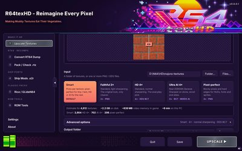</a><br><b>Upscale presets</b><br>Smart, Faithful, HD, Ultra AI, Pixel-perfect, with an estimate.</td>
<td width="33%" valign="top"><a href="docs/screenshots/upscale-compare.png">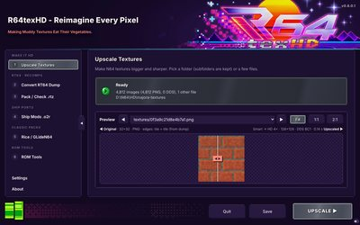</a><br><b>Before / after</b><br>Drag the line to compare the original and the result.</td>
<td width="33%" valign="top"><a href="docs/screenshots/convert-rt64-dump.png">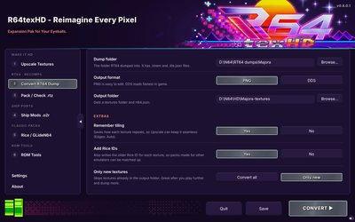</a><br><b>Convert RT64 Dump</b><br>RT64 dumps to PNG / DDS plus rt64.json.</td>
</tr>
<tr>
<td valign="top"><a href="docs/screenshots/pack-recomp-info.png">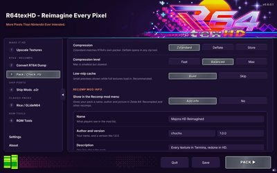</a><br><b>Pack .rtz</b><br>RT64's own layout, with Recomp mod info.</td>
<td valign="top"><a href="docs/screenshots/check-a-pack.png">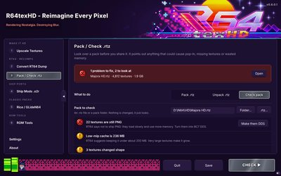</a><br><b>Check a pack</b><br>Problems first, with a one-click fix.</td>
<td valign="top"><a href="docs/screenshots/ship-mods-o2r.png">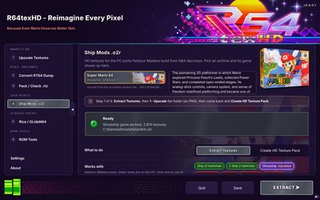</a><br><b>Ship Mods .o2r</b><br>Knows the game, finds your installed ports.</td>
</tr>
<tr>
<td valign="top"><a href="docs/screenshots/rice-gliden64.png">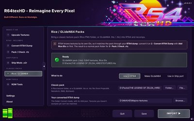</a><br><b>Rice / GLideN64</b><br>Classic packs into RT64, GLideN64 and Ship ports.</td>
<td valign="top"><a href="docs/screenshots/rom-tools.png">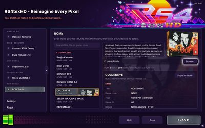</a><br><b>ROM Tools</b><br>Header, CIC, checksum, hashes and box art.</td>
<td valign="top"><a href="docs/screenshots/settings.png">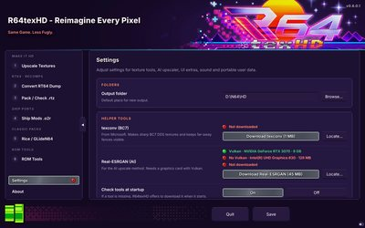</a><br><b>Settings</b><br>A box per area, with the graphics card check.</td>
</tr>
<tr>
<td valign="top"><a href="docs/screenshots/wizard-footer.webp">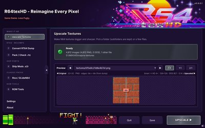</a><br><b>The wizard of R64</b><br>The progress bar, with scenes and fights (animated).</td>
<td valign="top"><a href="docs/screenshots/settings-sound.png">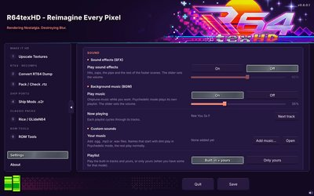</a><br><b>Sound and music</b><br>Volumes, now playing, your own sounds.</td>
<td valign="top"><a href="docs/screenshots/menu-folded.png">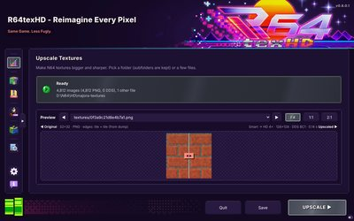</a><br><b>Folded menu</b><br>More room for the page; icons for each section.</td>
</tr>
</table>

**Portable:** nothing is installed. Settings, downloaded tools, your sounds and temporary files stay in a
`data` folder next to `R64texHD.exe`, never in AppData.

## The pages

### 1 · Upscale Textures

- A whole folder of PNG / DDS textures (subfolders kept) or picked files.
- **Presets**: **Smart** (default), **Faithful 2×**, **HD 4×**, **Ultra AI 4×**, **Pixel-perfect**, and
  **Save as preset** for your own. The options fold away under **Advanced options**; changing one makes it Custom.
- **Smart** looks at every texture (size, colours, transparency): tiny, font and HUD textures go
  pixel-perfect, big detailed ones go AI (when Real-ESRGAN is installed and the graphics card has Vulkan),
  the rest go HD 4×. The log says what each texture got.
- **Estimate** under the presets: disk size, video memory in game, time on this PC, and Smart's split.
- **Before / after preview** that re-renders whenever a setting changes.
- Methods Standard, Smooth, Pixel art, AI (Real-ESRGAN); 2× to 8× or fit to 512–4096 px.
- **Edges: Auto** keeps tiling floors and walls seamless using each texture's tiling from the RT64 dump.
- Output as the same format, PNG or DDS (BC1, BC3, BC7 via texconv, uncompressed), always with mipmaps;
  **Fences far away** keeps cut-out textures solid in the distance.

### 2 · Convert RT64 Dump

- Turns RT64 texture dumps (`.tmem` + `.tile.json`, from RT64's debugger: F1 › Textures › Start dumping
  textures) into PNG or DDS plus a ready-made `rt64.json`, with a port of RT64's own decoder.
- **Remember tiling** for Edges: Auto, **Add Rice IDs** for classic packs, and **Only new textures** to
  convert just what you dumped since last time.

### 3 · Pack / Check .rtz

- **Pack** a texture folder into an `.rtz` the way RT64's `texture_packer` does (Zstandard, Deflate or
  Store; low-mip cache for DDS streaming).
- **Recomp mod info**: a name, author, picture and on / off switch for the mod menu in Zelda 64:
  Recompiled and other recomps.
- **Check a pack** before you share it (PNG left in, missing files, DDS without mipmaps, cache size, very
  large textures…), and **Make them DDS** saves a fixed copy. **Unpack** any `.rtz` back into a folder.

### 4 · Ship Mods .o2r

- HD texture packs for the [Harbour Masters](https://www.harbourmasters.org/downloads) ports and other
  `.o2r` ports, in three steps: **Extract Textures** → upscale on page 1 → **Create HD Texture Pack**.
- **Knows the game**: the game is read from the archive itself, so new and renamed ports work too.
- **Finds your installed ports**: green = on this PC, red = not found; click one to use its archive and
  `mods` folder. Older `.otr` archives work too.

<details>
<summary>How the game is recognised, how ports are found, and the supported ports</summary>

- Every `.o2r` made from a ROM has a `version` file holding that ROM's CRC1 (header offset 0x10), written
  by both Torch and Shipwright's exporter (newer archives may also have it in `manifest.json`). R64texHD
  looks it up in a table of 773 retail ROM dumps covering 302 of the 303 library games, so
  `sm64.o2r` → Super Mario 64 → Ghostship.
- Mods R64texHD builds carry a small `r64texhd.json` with the game's CRC1, and folders from Extract
  Textures remember it too. Only when a file says nothing does it fall back to the file name (`mm.o2r`) or
  a port's folder in the path.
- The port search never uses Windows Search and only lists folders: places you've used before, then
  Desktop / Downloads / Documents / Games and each drive, skipping system folders. It stops once all are
  found or after 4 seconds. A folder counts as a port when it has the port's program, its own archive or
  a game archive for the port's game.
- HD textures are stored the way Harbour Masters' Retro tool stores them (RGBA32 at a whole multiple of the
  original size). With **In-game switch** they sit under `alt/`, so players flip them with "Use Alternate
  Assets" (Tab). Palette textures come out grey on extract: paint them in colour for HD.

| Port | Game |
| --- | --- |
| Ship of Harkinian | The Legend of Zelda: Ocarina of Time |
| 2 Ship 2 Harkinian | The Legend of Zelda: Majora's Mask |
| Ghostship | Super Mario 64 |
| SpaghettiKart | Mario Kart 64 |
| Starship | Star Fox 64 |
| Lighthouse | Banjo-Kazooie |
| Paperboat | Paper Mario |

</details>

### 5 · Rice / GLideN64

- **Use in RT64**: a classic pack (Rice PNG folder, or GLideN64 `.hts` / `.htc`) into an RT64 pack,
  matched through your converted dump (convert it with **Add Rice IDs** first).
- **Make GLideN64**: a `.hts` pack for Project64, RetroArch, RMG and BizHawk.
- **Use in a Ship port**: a classic pack into a Ship port `.o2r` mod.
- Rice IDs are worked out the way RT64's own `texture_hasher --rice` does. Packs of several GB are read a
  texture at a time.

### 6 · ROM Tools

- Pick your ROM folder (subfolders too: `.z64`, `.v64`, `.n64`, `.zip` and more) and click a ROM.
  ROMs are only read, never changed.
- Box art and a short description for 303 North American games, matched by game ID, so any region shows
  the same box. The counter shows how much of the library you have.

<details>
<summary>What the ROM details show</summary>

- **Game**: title, game code, type (cartridge, 64DD…), game ID, region with NTSC / PAL, and version.
- **File**: name, folder, byte order, size in MB and Mbit, the ROM inside a `.zip`, padding at the end.
- **Boot and checksum**: the CIC lockout chip, and whether the header checksum (CRC1 / CRC2) matches the
  one the boot code calculates (following `n64crc.c` for CIC-6101/6102, 6103, 6105 and 6106). Also the entry
  point, clock rate and libultra version.
- **Hashes**: CRC32, MD5 and SHA-1 in `.z64` order, the same as No-Intro, so `.v64` / `.n64` copies match.
- **Inside the ROM**: a map of the header, boot code and game data; for Zelda 64 engine games, the file
  table with the build name and date.

The library (`app/assets/n64/games.json`) is made by `build/n64-library/make-games.py`, with game codes
from the [libretro N64 databases](https://github.com/libretro/libretro-database).

</details>

### Settings

| Box | What's in it |
| --- | --- |
| **Folders** | The default output folder. |
| **Helper tools** | texconv (BC7) and Real-ESRGAN (AI), one-click downloads checked against a fixed checksum. Above Real-ESRGAN, a line per graphics card: Vulkan or not, model and video memory. |
| **Upscaling** | AI upscaling (model, graphics card, memory use) and Performance (worker threads, largest texture). |
| **Look and feel** | Splash screen and catchphrases; Extras › Wizard of R64 (animations, fights, idle, poking, Psychedelic mode, scenes, fight record). |
| **Sound** | Sound effects and background music, each with on / off and a volume slider; now playing; custom sounds. |
| **App** | Desktop shortcut and the portable data folder. |

The left menu folds into a narrow strip of icons with the grey tab on its edge.

## The wizard of R64

<a href="docs/screenshots/wizard-footer.webp">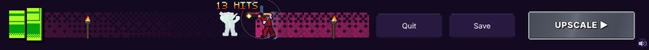</a>

*Click for the animation.*

- **The footer is the progress bar.** It fills from the right toward the green pipe (the Welcome button),
  and the Windows taskbar button shows the same progress.
- **While a job runs**, the wizard plays scenes that fit the time left: classic scenes, **fights** (goblin,
  golem, robot, his dark twin) and a **bonus stage** after every third win. When the job ends mid-fight he
  wins on the spot; a cancel or an error ends in a burst.
- **Psychedelic mode** (asked on first launch, [see it](docs/screenshots/first-launch-psychedelic.png), or in Settings) adds trip scenes, the machine elf and its own
  music.
- **When nothing runs** he peeks out of the pipe now and then with a catchphrase. Click him to poke him.
- **Sound**: background music (a normal playlist, and one for Psychedelic mode), sound effects, and your own
  files in `data\music` and `data\sounds`. The speaker in the bottom right corner mutes everything.
- **Scenes download once**: the classic scenes ship with the app; the fights and trips (about 30 MB)
  download in the background on first run. Offline, the classic scenes still play.

Everything here can be turned off in Settings › Look and feel and Settings › Sound.

## Download and run

1. Download `R64texHD-v0.8.0.1-Windows.zip` from [Releases](../../releases).
2. Unzip it anywhere you can write to, for example `C:\Tools\R64texHD-v0.8.0.1`.
3. Run **R64texHD.exe**. The first launch asks about the optional helper tools and Psychedelic mode.

**Updating:** unzip the new version next to the old one and copy the old `data` folder into it to keep
your settings, tools, sounds and downloaded scenes.

The release is not code-signed, so Windows SmartScreen may warn the first time: choose
**More info › Run anyway**.

## Building from source

The app is plain JavaScript on [Electron](https://www.electronjs.org/) 38 with no npm dependencies:
everything (PNG and DDS codecs, block encoders and decoders, the upscaler, `.rtz` zip writer) is in
`app/core`. Run it during development with `electron app`.

```
build/package.sh
```

Needs `curl`, `unzip` and Python 3 with Pillow (Linux, macOS, or Windows with Git Bash / WSL). It
downloads Electron 38.4.0 for win32-x64, sets the exe icon and version info, and makes two files to
attach to the release:

- `dist/R64texHD-v<version>-Windows.zip`: the app, with the starter scenes;
- `dist/R64texHD-v<version>-scenes.zip`: the fights and trips the app downloads on first run, from the
  release tagged `v<version>` (set `SCENES_URL` to use another).

The version is set in one place, `app/package.json`.

<details>
<summary>Project layout</summary>

```
app/
  main.js            window, settings (portable data folder), dialogs, tasks, downloads
  preload.js         the bridge between the page and the app
  ui/index.html      the pages, splash screen, live preview, Settings
  ui/wizard.js       the footer: progress bar and scenes      ui/music.js   background music
  ui/nav-icons.js    folded menu icons                         ui/pixel-icons.js  status icons
  core/              png, dds, bc, upscale, smart (Smart mode), tmem (RT64 dumps), tiling, rt64db,
                     rtz, recomp, check, o2r (Ship ports), rice + legacy (GPL), rom, scenes,
                     gpuinfo (graphics card check), tasks + worker (parallel jobs)
  assets/            scenes (starter set), sounds, music, nav icons, N64 library and box art
build/               package.sh; wizard/ (scene toolkit); ui-preview/ (screenshots, self-test);
                     nav_icons.py; n64-library/
tests/               automated tests
docs/                README.txt shipped in the release, screenshots (+ thumbs)
```

</details>

## Testing

```
node --test tests/*.test.js
```

Needs Node 22.15 or newer. The tests cover the image formats and mipmaps, RT64 dumps and Edges: Auto,
`.rtz` packs and Recomp info, Check a pack, Ship `.o2r` mods, Rice IDs (against RT64's own C++),
GLideN64 packs, ROM Tools, Smart mode and the estimate, the scenes pack and the graphics card check.
`build/ui-preview/electron-selftest.js` clicks through the real app (pages, jobs, presets, footer,
sound, menu).

## Why was this made?

R64texHD was created to simplify the entire RT64 texture upscaling workflow — from extracting textures
and converting them to PNG/DDS, to upscaling them and repacking them into `.rtz` texture packs for
compatible N64 emulators, renderers, and ports — all in one tool.

## How this was made

R64texHD was vibe coded with **Claude Opus 5.5**. The author has **zero** understanding of code: every
line here came from describing what the tool should do, testing it, and asking for changes until it
worked. What the author did bring was the drive to make something and to give the community a free tool
for building HD texture packs.

If you know your way around code, issues and pull requests are welcome. If you don't, that's fine too:
this project shows that you can still build something useful.

## Licence

GPL-2.0-or-later, see [LICENSE](LICENSE). From v0.7.1.1 R64texHD is GPL because the Rice / GLideN64
support uses the Rice texture ID formula from GLideN64 and Rice Video (GPL), as RT64's own
`texture_hasher` does. Earlier versions were MIT. Parts are ported from RT64 and bcdec (both MIT); see
[THIRD_PARTY_NOTICES.md](THIRD_PARTY_NOTICES.md). The R64 icon, splash, header artwork, the wizard style
sheet, the menu icon pictures and the background music were supplied by the project author.

<details>
<summary>Credits</summary>

- **N64 box art scans** (ROM Tools): **Kondorito**, from the
  [Nintendo 64 3D Boxes Pack (Real Version)](https://emumovies.com/files/file/3117-nintendo-64-3d-boxes-pack-real-version)
  on EmuMovies.
- **Sound effects**: [512 Sound Effects (8-bit style)](https://opengameart.org/content/512-sound-effects-8-bit-style)
  by Juhani Junkala / SubspaceAudio (CC0) and the UI Sound Effects Free Sampler by **leckie1989**
  (CC BY 4.0), from OpenGameArt.
- **Splash catchphrase font**: [Pixelfy](https://shoppy.gg/@stefiejustprince/groups/IpAo0ml) by
  stefiejustprince, under its own licence (personal use; see `app/ui/fonts/Pixelfy-LICENSE.txt`), not
  covered by R64texHD's GPL.
- **ROM CRC1 table** for Ship Mods: the [mupen64plus](https://github.com/mupen64plus/mupen64plus-core)
  ROM database; GameCube versions from the Shipwright and 2ship2harkinian sources.
- **Game codes** for the box art: the [libretro-database](https://github.com/libretro/libretro-database)
  N64 lists (No-Intro and serial).

</details>
